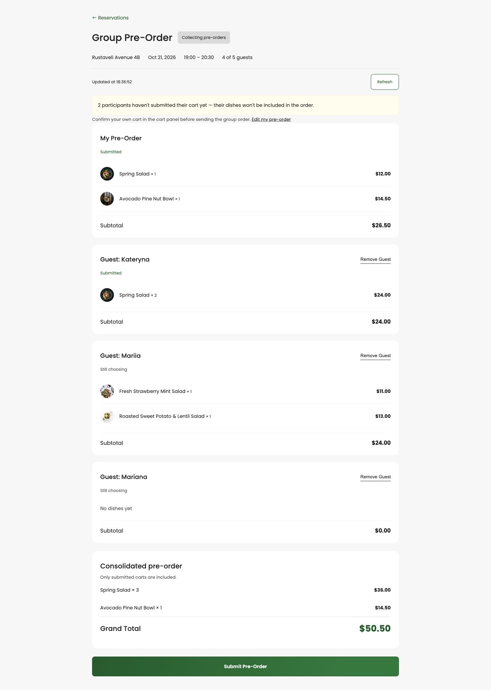
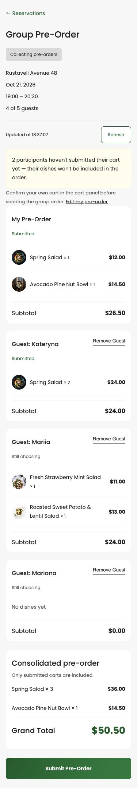
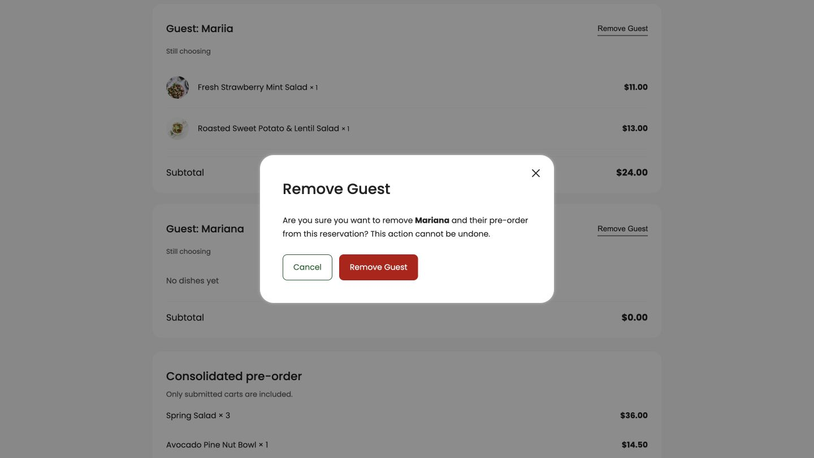
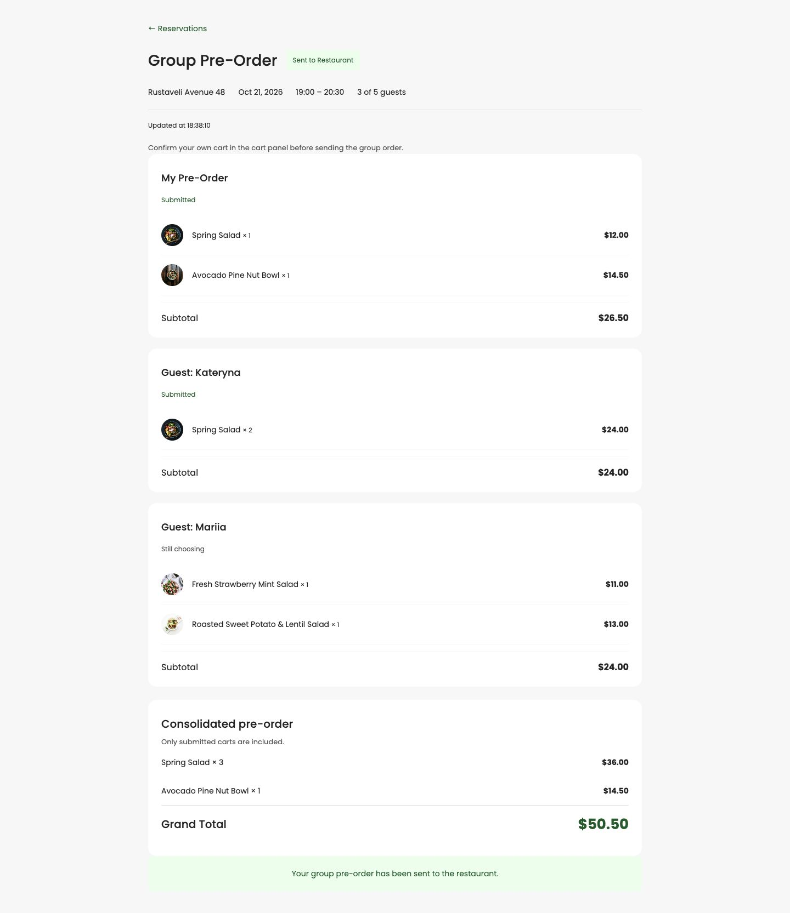

# Owner Group Pre-Order — виконане домашнє завдання

Реалізовано backend рівні 1–3 та frontend рівні 1–3 із бонусом Remove Guest. Новий код — у релізі `1.2.0`.

## Як відкрити

На [живому сайті](https://d2e716owoxyulz.cloudfront.net) увійдіть, створіть бронювання на 2–4 гостей і натисніть **Reservations → Group Pre-Order**. Адреса сторінки: `/reservations/:reservationId/group-order`.

Для локальної перевірки з моками:

```bash
cd frontend/restaurant-frontend-app
npm ci
npm start
```

Відкрийте `http://localhost:4200/reservations/demo-reservation/group-order?demo`. Мок-авторизація та mock interceptor реєструються виключно в dev-режимі; production API перевіряє справжні Cognito JWT.

## Реалізовано

- Owner бачить імена, страви, кількості, Subtotal і статус кожного кошика.
- Власний кошик позначено My Pre-Order.
- Consolidated pre-order об’єднує однакові страви за dishId, включає лише submitted-кошики. Grand Total рахується з цього списку.
- Непідтверджені кошики видно, але їхня вартість не входить до Grand Total.
- Submit із підтвердженням змінює статуси замовлення на SubmittedByCustomer і групи на Submitted.
- Оновлення замовлення, статусу групи та збереження первісного кошика Owner виконуються однією DynamoDB-транзакцією. Умова Open захищає від подвійного чи конкурентного Submit.
- До Submit Owner-сесія є стабільною проєкцією чинного особистого pre-order; при груповому Submit її первісний знімок зберігається, щоб після перезавантаження не подвоїти гостеві страви.
- Після Submit екран лише для перегляду, фонове оновлення зупиняється. Сервер відхиляє видалення гостей і редагування особистого кошика у вже закритій групі.
- Remove Guest має діалог підтвердження, не дозволяє видалити Owner чи учасника іншої групи і повертає оновлений список та суму. Видалення перевіряє Open атомарно.
- Поки група Open, кожні 15 секунд завантажуються кошики й статус. Немає паралельних запитів; таймер завершується при виході зі сторінки.
- Є Refresh, Updated at, тихе повідомлення про помилку фонового оновлення, loading/error/empty стани.
- Мобільну верстку перевірено на ширині 375 px.

## API

Усі Owner-операції вимагають Cognito JWT і перевіряють CustomerId батьківського reservation на сервері.

| Метод | Шлях | Результат |
|---|---|---|
| GET | `/guest/groups/{groupId}/sessions` | Учасники, їхні кошики та загальна сума всіх кошиків |
| GET | `/reservations/{reservationId}/guest-session-id` | Стабільний id Owner-сесії |
| POST | `/group-reservations/{groupId}/submit` | `{ reservationId }` → об’єднані dishId/quantity |
| DELETE | `/guest/groups/{groupId}/sessions/{sessionId}` | Оновлені учасники та сума |
| GET | `/reservations/{reservationId}/group-order` | Приватні дані шапки Owner для повних або вже submitted-груп |

Наявні публічні invite/status endpoint-и використано повторно. Приватний endpoint шапки дозволяє Owner повторно відкрити групу, коли запрошення вже не приймає гостей.

Помилки: 401 без входу; 403 для іншого власника; 404 для відсутніх даних; 400 для невалідного reservationId, відсутнього order, порожніх/непідтверджених кошиків, повторного Submit чи зміни закритої групи.

## Перевірки

- **169/169 backend tests passed**, включно з 20 новими тестами OwnerGroupOrderService та 8 перевірками авторизації.
- **53/53 цільові frontend-перевірки passed**: 46 готових тестів домашки, 4 перевірки розмежування Owner/Guest токенів і 3 регресійні перевірки часового поясу.
- TypeScript app/spec: обидві перевірки пройшли.
- Production build: пройшов, перевірка конфігурацій bundle пройшла.
- Повний frontend suite: **257 passed, 47 failed**. Ті самі 47 випадків відтворено на попередній версії з main — нових падінь немає. Частина старих тестів пошуку столиків додатково залежить від реального часу доби; вони не змінювалися цією фічею.

Команди:

```bash
# Backend
cd backend/restaurant-backend-app
dotnet test Tests/APIHandler.Tests.csproj --configuration Release

# Frontend
cd frontend/restaurant-frontend-app
npx tsc -p tsconfig.app.json --noEmit
npx tsc -p tsconfig.spec.json --noEmit
npm run test:hw -- --include=src/app/services/pre-orders/pre-orders.service.spec.ts
BACKEND_URL=https://YOUR_API_ID.execute-api.eu-north-1.amazonaws.com/develop npm run build
```

## Реальний інтеграційний сценарій AWS

На окремому демонстраційному бронюванні на 4 листопада виконано:

1. Owner додав і підтвердив Spring Salad × 1 ($14).
2. Workshop Submitted підтвердив Spring Salad × 2 ($28).
3. Workshop Draft залишив Avocado Bowl × 1 ($22) непідтвердженим.
4. З дозволу користувача видалено порожнього тестового гостя Workshop Remove; список оновився.
5. Owner отримав Spring Salad × 3 і Grand Total $42, без $22 із чернетки.
6. Submit успішно змінив групу на Submitted і order на SubmittedByCustomer.
7. Перезавантаження зберегло read-only стан і $42 без подвоєння страв Owner.
8. Перевірка записів DynamoDB підтвердила quantity 3 у спільному order, quantity 1 у збереженому кошику Owner, відсутність видаленого гостя.
9. Спроба GET приватних кошиків без токена повернула 401.

Оплату не виконували. Гостьові токени не збережено в репозиторії.

## Скріншоти









## Використання AI

Codex використано для аналізу вихідного проєкту й умов домашнього завдання, реалізації API та UI, тестів, AWS deployment і перевірки через браузер. Готові тести домашнього завдання взято з наданого навчального архіву; додаткові тести написано для серверних бізнес-правил та інтеграції токенів.
